<div align="center">



<a href="https://git.io/typing-svg">
  
</a>

</div>


## 🐾 Kimoyo Card — About Me

```yaml
name: Kishan Sanjay Gurav
role: Final-Year B.E. Student, AI & Machine Learning
university: RNS Institute of Technology (RNSIT), Bengaluru
cgpa: 8.96 / 10(6th sem)
graduation: 2027
focus: [Applied AI, Deep Learning, Generative AI, Blockchain, NLP, Full-Stack Dev]
looking_for: Software Engineer Intern roles
certifications:
  - IBM Professional Certificate — Full Stack Software Development
  - IBM Professional Certificate — AI Development
  - Retrieval Augmented Generation (RAG) — DeepLearning.AI
  - NVIDIA: Prompt Engineering & Data Analysis — Coursera
```

<table>
<tr>
<td width="50%" valign="top">

### 🔭 Vibranium Lab — Currently working on
AI/ML projects, Generative AI applications, and full-stack web application — including a vision-based traffic violation detection system and blockchain-backed compliance tooling.

### 🛡️ Dora Milaje Alliances — Looking to collaborate on
AI/ML, Generative AI, full-stack development, blockchain, and open-source projects.

### 🧪 Shuri's Lab Requests — Looking for help with
Advanced DSA, system design, scalable backend architecture, and real-world AI deployment.

</td>
<td width="50%" valign="top">

### 📚 Wakandan Academy — Currently learning
Machine Learning, Deep Learning, Generative AI, RAG, Cloud & DevOps, and scalable software engineering and Developments.

### 💬 Council of Elders — Ask me about
AI ml, Generative AI, RAG, Full Stack Developments, REST APIs, Backend Development, Blockchain.

### ⚡ Heart-Shaped Herb — Fun fact
I enjoy turning complex real-world problems into practical, scalable softwares and AI solutions 

</td>
</tr>
</table>


## 🚀 Missions from Wakanda — Featured Projects

<table>
<tr>
<td width="50%">

### 🩺 [VruCare — RAG-Based GenAI System for Kidney Stone](https://kidneystone-rag-chatbot.streamlit.app/)
Domain-specific RAG chatbot delivering accurate, document-grounded kidney stone info from 20+ curated medical PDFs. Hybrid **BM25 + FAISS** retrieval with RRF, Hugging Face embeddings, and hallucination guardrails. Deployed on Streamlit.

`Python` `RAG` `LangChain` `FAISS` `BM25` `Streamlit`

</td>
<td width="50%">

### 🔗 [PFTUS — Blockchain Public Fund Tracking System](https://github.com/Kishangurav/v2)
Transparency platform for government fund management with milestone-based smart contracts, NFT approval verification, and real-time public audits on **Polygon**. Role-based dashboards for Government, Contractors, Auditors, and Citizens. 🏆 1st Runner-Up, first hackathon.

`Solidity` `Hardhat` `Next.js` `React` `Web3/EVM` `MetaMask`

</td>
</tr>
<tr>
<td width="50%">

### 🚦 [Vision-Based Traffic Violation Detection](https://github.com/kishangurav/traffic-violation-detection)
Real-time system using **YOLOv8** and a custom **OpenCV** multi-object tracker to detect red-light jumping, speeding, and helmet violations from live video, with evidence capture and a live **FastAPI + React** dashboard. Processes 25+ FPS, 950+ violations flagged in testing.

`YOLOv8` `OpenCV` `FastAPI` `React` `Deep Learning`

</td>
<td width="50%">

### ⚖️ ConsentLedger — Blockchain-Enforced Legal NLP Framework *(ongoing)*
AI-powered framework enforcing RBI Account Aggregator consent policies. Combines **Legal-BERT** entity extraction, **T5** legal-text simplification, and **Ethereum** smart contracts. Legal-BERT F1: 0.910, T5 ROUGE-L: 0.74, 100% adversarial rejection by the ConsentRegistry contract.

`Legal-BERT` `T5` `Solidity` `Ethereum` `NLP`

</td>
</tr>
<tr>
<td colspan="2">

### 📸 [SnapNEarn — AI Traffic Safety & Rule Enforcement](https://snapnearn-ai-traffic-safety.onrender.com) · [GitHub](https://github.com/Kishangurav/SnapNEarn-AI-Traffic-Safety)
AI-powered platform letting users report traffic violations via image evidence, OCR, and GPS data. **Node.js/Express** REST APIs with JWT auth and role-based access, **MongoDB Atlas** storage, **Apache Kafka** for event-driven processing, and **Docker/Kubernetes** for containerized deployment on Render.

`Node.js` `Express.js` `MongoDB Atlas` `Kafka` `Docker` `Kubernetes` `OCR`

</td>
</tr>
</table>

🏆 **1st Runner-Up** — EPOCH '26 Grand National 24-Hour Hackathon, Vemana Institute of Technology (Cybersecurity & Blockchain track) — ₹30,000 prize, 200+ competing teams


## 📿 Kimoyo Beads — Connect With Me

<div align="center">

<a href="https://www.linkedin.com/in/kishan-sanjay-gurav-7777i/" target="_blank"></a>
<a href="https://kishan-sanjay-gurav.netlify.app/" target="_blank"></a>
<a href="mailto:kishansanjaygurav23aiml@rnsit.ac.in"></a>
<a href="https://github.com/Kishangurav" target="_blank"></a>

</div>

## ⚔️ Vibranium Arsenal — Tech Stack

<div align="center">

**Languages & Backend**
<br>


**Frontend**
<br>


**AI / ML / Data**
<br>


**Databases**
<br>


**DevOps & Cloud**
<br>


**Blockchain**
<br>


</div>


## 📊 Wakandan Intelligence Report — GitHub Stats

<div align="center">


</div>

## 🐆 The Panther Runs the Grid

<div align="center">


</div>

## 📜 Words of Wakanda — Random Dev Quote

<div align="center">

</div>


<div align="center">

 *Wakanda Forever. If you like what you see, feel free to explore my repositories and connect!*

</div>
