🐾 Kimoyo Card — About Me
Kishan Sanjay Gurav
🎓 Final-Year B.E. Student — AI & Machine Learning, RNS Institute of Technology (RNSIT), Bengaluru
📅 Graduation: 2027 · 📈 CGPA: 8.96/10 (6th semester)
🎯 Focus: Applied AI, Deep Learning, Generative AI, Blockchain, NLP & Full-Stack Development
💼 Open to: Software Engineer Internship Roles

Certifications:

IBM Professional Certificate — Full Stack Software Development
IBM Professional Certificate — AI Development
Retrieval Augmented Generation (RAG) — DeepLearning.AI
NVIDIA: Prompt Engineering & Data Analysis — Coursera
🔭 Vibranium Lab — Currently Working On
AI/ML projects, Generative AI applications, and full-stack web applications, including a vision-based traffic violation detection system and blockchain-backed compliance tooling.

🛡️ Dora Milaje Alliances — Collaboration
AI/ML, Generative AI, full-stack development, blockchain, and open-source projects.

🧪 Shuri's Lab Requests — Currently Exploring
Advanced DSA, system design, scalable backend architecture, and real-world AI deployment.

📚 Wakandan Academy — Currently Learning
Machine Learning, Deep Learning, Generative AI, RAG, Cloud & DevOps, and scalable software engineering.

💬 Council of Elders — Ask Me About
AI/ML, Generative AI, RAG, full-stack development, REST APIs, backend development, and blockchain.

⚡ Heart-Shaped Herb — Fun Fact
I enjoy turning complex real-world problems into practical, scalable software and AI solutions.

🚀 Missions from Wakanda — Featured Projects
🩺 VruCare — RAG-Based GenAI System for Kidney Stone
Domain-specific RAG chatbot delivering accurate, document-grounded kidney stone info from 20+ curated medical PDFs. Hybrid BM25 + FAISS retrieval with RRF, Hugging Face embeddings, and hallucination guardrails. Deployed on Streamlit.

Python RAG LangChain FAISS BM25 Streamlit

🔗 PFTUS — Blockchain Public Fund Tracking System
Transparency platform for government fund management with milestone-based smart contracts, NFT approval verification, and real-time public audits on Polygon. Role-based dashboards for Government, Contractors, Auditors, and Citizens. 🏆 1st Runner-Up, first hackathon.

Solidity Hardhat Next.js React Web3/EVM MetaMask

🚦 Vision-Based Traffic Violation Detection
Real-time system using YOLOv8 and a custom OpenCV multi-object tracker to detect red-light jumping, speeding, and helmet violations from live video, with evidence capture and a live FastAPI + React dashboard. Processes 25+ FPS, 950+ violations flagged in testing.

YOLOv8 OpenCV FastAPI React Deep Learning

⚖️ ConsentLedger — Blockchain-Enforced Legal NLP Framework (ongoing)
AI-powered framework enforcing RBI Account Aggregator consent policies. Combines Legal-BERT entity extraction, T5 legal-text simplification, and Ethereum smart contracts. Legal-BERT F1: 0.910, T5 ROUGE-L: 0.74, 100% adversarial rejection by the ConsentRegistry contract.

Legal-BERT T5 Solidity Ethereum NLP

📸 SnapNEarn — AI Traffic Safety & Rule Enforcement · GitHub
AI-powered platform letting users report traffic violations via image evidence, OCR, and GPS data. Node.js/Express REST APIs with JWT auth and role-based access, MongoDB Atlas storage, Apache Kafka for event-driven processing, and Docker/Kubernetes for containerized deployment on Render.

Node.js Express.js MongoDB Atlas Kafka Docker Kubernetes OCR

🏆 1st Runner-Up — EPOCH '26 Grand National 24-Hour Hackathon, Vemana Institute of Technology (Cybersecurity & Blockchain track) — ₹30,000 prize, 200+ competing teams

📿 Kimoyo Beads — Connect With Me

⚔️ Vibranium Arsenal — Tech Stack
Languages & Backend

           

Frontend

      

AI / ML / Data

           

Databases

     

DevOps & Cloud

        

Blockchain

      

📊 Wakandan Intelligence Report — GitHub Stats

 

🐆 The Panther Runs the Grid

📜 Words of Wakanda — Random Dev Quote

  

Wakanda Forever. If you like what you see, feel free to explore my repositories and connect!

Meet Codex in the desktop app
Codex helps you make the change wire it up and keep shipping. Included for free in your ChatGPT plan.

